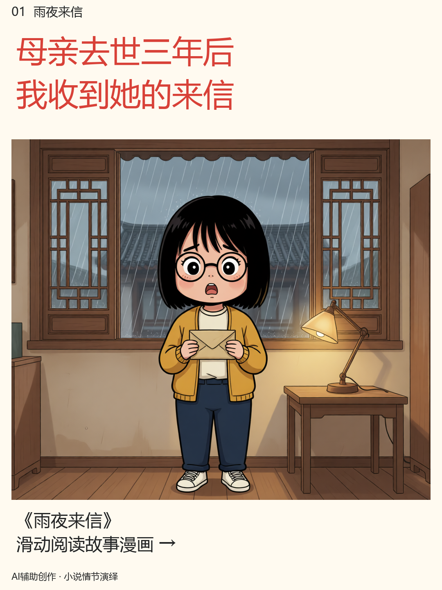

# 知乎故事 CPA 漫画图集 Skills

输入 **标题（任务关键词）+ 小说/推文正文**，输出可下载的多图漫画 ZIP。适合在 Codex 中调用，也支持独立命令行。默认接入 Agnes，文本和图片模型可分别配置。

这是原创实现。工作流参考 [novel-comic-promo](https://github.com/CYU1102/novel-comic-promo) 的角色设定、分镜和质检思路，未复制其图像、故事或代码。未能直接读取的第三方抖音短链不作为已经完成的画质对标。

## 产出什么

- 连续编号的封面、正文漫画、任务关键词尾页。
- 小红书 `1080×1440`、抖音 `1080×1920`，或 `1080×1620` 竖图。
- 中文字体可靠排版、对话说话者标签、总览图。
- 分镜 JSON、原画提示词、发布文案、文件校验报告。
- `comic-album.zip`，按阅读顺序上传 `images/01.png` 至末张。

**弱模型的处理方法：** 一次只生成一个简单镜头，每页用两张独立原画拼成漫画；固定角色外观，支持时用同一张角色参考图；模型不负责写中文字。这样可以改善文字与分镜稳定性，但画面水平、手部和角色一致性仍受模型能力限制，需要逐页看图验收。

真实案例验证（2026-10-19）：使用用户提供的小说，标题为“测试小说”，通过 `agnes-image-2.5-flash` 实际完成 16 张漫画（1080×1440），逐页检查并重绘 1 格后交付 ZIP。正文及重绘共记录 29 次成功图片请求，间隔约 60 秒；该案例使用固定人物描述的文生图模式。小说和案例产物保存在本机。11 项自动测试通过，覆盖打包、中文排版、缓存续跑、原文引句、有界修复、跨重启限频和整体请求超时。

下图为仓库原创故事的早期 2.1 模型示例，用于展示排版结构。



## 在 Codex 使用

将 `skills/zhihu-comic-cpa` 整个文件夹放入 `~/.codex/skills/`，或项目中的 `.agents/skills/`。不要只复制 `SKILL.md`。安装 Python 依赖后，可以直接这样说：

> 使用 $zhihu-comic-cpa。标题/关键词：雨夜来信。正文：……。做 16 张小红书漫画，使用我本机配置的 Agnes，给我完整 ZIP。

Codex 会完成分镜并调用脚本，而不是只给出提示词。技能位于 [SKILL.md](skills/zhihu-comic-cpa/SKILL.md)。

## 本地运行

需要 Python 3.10+ 和中文字体。Windows 自动寻找微软雅黑，macOS 自动寻找苹方；Linux 安装 Noto Sans CJK，或设置 `COMIC_FONT` 为字体路径。仓库不分发商业字体。

```powershell
python -m pip install -r requirements.txt
Copy-Item .env.example .env
# 只在本机 .env 中填写 AGNES_API_KEY，不要把真实 Key 发到 GitHub。
python skills/zhihu-comic-cpa/scripts/comic.py doctor
```

先用原创演示故事测试完整出图：

```powershell
python skills/zhihu-comic-cpa/scripts/comic.py run --title "雨夜来信" --story examples/story.txt --plan examples/plan.json --pages 5
```

只给标题与正文，让配置的文本模型自动编剧（默认总图数 16）：

```powershell
python skills/zhihu-comic-cpa/scripts/comic.py run --title "真实任务关键词" --story "story.txt" --platform douyin
```

结果位于 `runs/关键词-摘要/`。失败后重复同一命令即可续跑，已成功的原画不会重新生成。修改故事、分镜或图片模型会进入新的产物目录，避免把旧图混入新故事。文字模型返回非法分镜时停止并报告；可在 Codex 中修订 JSON 后用 `--plan` 接着制作。

演示故事和关键词只用于技术验证，不能作为真实 CPA 任务。正式使用时核对右豹任务的改编授权、准确关键词、搜索平台与引导要求，并在 `config.local.json` 配置尾页。工具不会登录右豹、领取任务、读取账号密码或替你发布到社媒。

## 模型配置

复制 `skills/zhihu-comic-cpa/config.example.json` 为仓库根的 `config.local.json`，按需修改 `text` / `image` 中的 `base_url`、`model`、`api_key_env`。运行时追加 `--config config.local.json`。没有该参数就使用示例默认配置。

```json
{
  "image": {
    "provider": "agnes",
    "model": "agnes-image-2.5-flash",
    "supports_reference": false
  },
  "render": {"style": "flat"},
  "promotion": {"destination": "知乎"}
}
```

默认图片请求需要 `AGNES_API_KEY`；使用 `--plan` 时不需要文本模型 Key。Key 只能通过环境变量或本机 `.env` 配置。配置递归覆盖默认值，`extra` 整体替换。其他 OpenAI Images Generations 兼容服务和协议限制详见 [模型接入](skills/zhihu-comic-cpa/references/providers.md)。默认预算每次最多新生成 40 张原画（HTTP 重试另计），需要更多时传 `--max-image-calls 100`。无参考图的模型设 `supports_reference: false`。

2.5 默认使用 `size: "1K"` 与画面比例，以固定人物描述进行文生图；参考图通道可用时，将 `supports_reference` 设为 `true`。图片请求每 60 秒最多一次，重试及重启续跑也会限频。当前网络若无法连接国际主域名，可将 `base_url` 改为同一国际服务的备用地址 `https://apihub.agnes-ai.cn/v1`。本机 `runs/.cache/agnes-requests.jsonl` 可核对实际请求间隔，不含密钥或小说内容。

Agnes 的端点、模型名参考 [官方 API 仓库](https://github.com/AgnesAI-Labs/AgnesAI-Models)；模型可用性、免费额度和价格随账号与供应商变化，不承诺永久免费，不自动购买或切换付费服务。

## 验证与离线测试

```powershell
python -m unittest discover -s tests -v
python skills/zhihu-comic-cpa/scripts/comic.py run --title "雨夜来信" --story examples/story.txt --plan examples/plan.json --pages 5 --mock
python skills/zhihu-comic-cpa/scripts/comic.py verify "runs/实际生成的目录"
```

`--mock` 只验证排版、顺序和压缩包，图片与 ZIP 明确标记“离线排版测试”，不会被当成 AI 画面，也不会在远程 API 失败时自动启用。真人设与剧情一致性不能靠文件校验判断，需审阅总览和原图。

## 公共仓库与素材

代码及本项目原创演示故事采用 MIT 许可证。其他人提供的小说和推广素材仍归其权利人。只使用已获改编/推广授权的内容，不搬运参考账号的画面、水印或人物资产。不承诺过审、流量或佣金结果。

`.env`、本机配置、运行产物和缓存默认忽略。发布前检查暂存内容，尤其不要自行把真实账号、Key、小说全文或右豹任务私有截图加入 Git。交付 ZIP 使用固定文件白名单，不打包配置、密钥、原文全文或缓存。社媒发布与领取 CPA 任务需另行操作。
