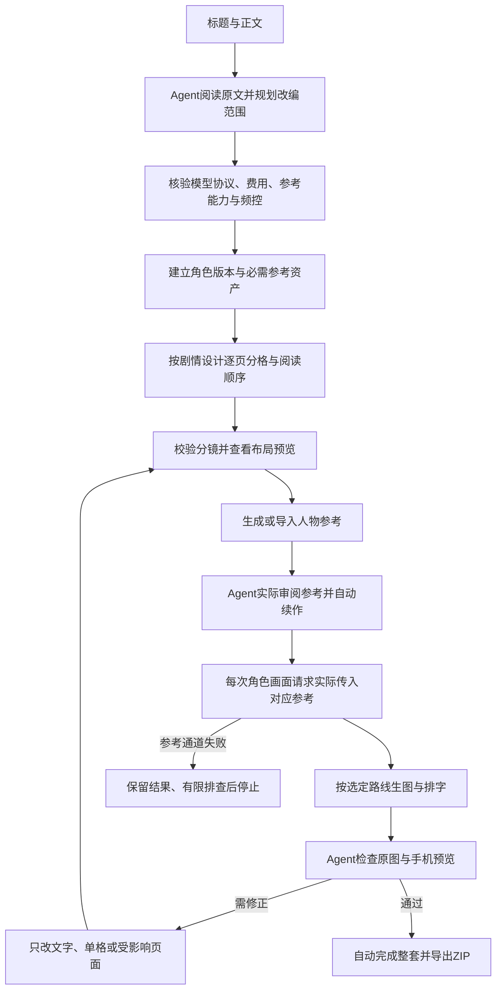

# Skills v3.1：人物参考必需、自动完成、按分镜分格

日期：2026-10-20。用户明确要求修改并完成Skills；本方案已获本轮指令授权，直接实施，不再等待方案或试样风格确认。旧版档案保留为历史，以下规则替代其可选参考和试样确认节点。

## 修订目标与执行规则

| 用户要求 | v3.1实现 |
|---|---|
| 人物参考图必须有 | 每个出镜角色版本绑定参考资产；每次含该角色的请求实际附带图片。缺失、未审阅、协议不支持或参考通道失败时停止，不能无参考降级。导出再次检查实际数量、绑定和摘要。 |
| 试样风格无需确认 | 小批试制、参考审阅和风格纠偏由agent内部完成；满足质量检查后自动做完、导出整套。只有用户日后另行明确要求，才增加中途确认。 |
| 根据分镜确定分格 | agent根据剧情节拍、主次镜头、动作因果、对白量和手机可读性选择每页格数、面积和阅读顺序。先查看布局预览，拒绝重叠；全套重复同一几何需具体依据。示例1、3、4格，不设格数配额。 |

人物参考是必要输入，不能承诺仅凭参考参数就保证视觉一致；agent仍须逐页核对脸、发型、服装、身材比例和状态。全套两格并非永远错误，但不能在未考虑分镜时作为默认模板。

## 当前流程

## 数据与代码

仍使用version3分镜结构，软件版本升为3.1.0。新增必需字段：角色的`reference_assets:{版本:[资产ID]}`，每页的`layout:{rationale,reading_order}`。`page.references`可补充其他风格资产，不能通过清空它移除角色参考。执行器按实际演员分别选择整页或单格参考，保存参考ID、图片摘要及角色版本绑定。共用角色表可绑定多名人物；无人物道具格不需添加无关角色图。

资产支持`local_path`导入，相对路径以计划文件所在目录为基准；导入和生成资产均须agent看图并记录SHA。派生参考使用父图前同样审阅。生成或审核中断后可从已有结果续作。图片任务按已核验容量分发，首次错误后不再启动剩余任务；已经在途的结果保留。未知提交状态继续沿用持久保护，不能删除记录重发。

新增`v3 layout --plan ... --story ... --out ...`，不调用模型，绘制每格位置、阅读顺序、文字区和人物保护区。正常run同样保存布局预览。可变分格渲染沿用实际矩形与比例匹配，不强制裁切。示例覆盖单幅建立场景、三格行动递进、四格悬念与反应；三种生成路线均可配置。

导出强制验证角色参考提交记录，待审导出也不能绕过。制作包新增实际参考PNG与可移植分镜，去掉本机原始参考路径。v3.0无参考图片和旧版固定模板不得作为本版合格成品。迁移v1会生成参考资产任务，但仍须agent重新导演，而不是直接沿用旧布局。

## 验证记录与边界

本地33项测试通过，包括参考绑定必需、每个请求的实际Base64输入、未审参考与不支持参考的模型拦截、参考故障后停止分发、零参考不能导出、可移植制作包、1／3／4格及三种路线。另完成布局预览、离线排版与MOCK打包；这些不代表真实画质已验证。

按[Agnes当前国际站官方文档](https://wiki.agnes-ai.com/en/docs/agnes-image-25-flash)核验Data URI参考参数与60–360秒超时说明。本次保留用户指定模型、串行、读取240秒／总时限360秒及60秒起始间隔。官方主地址两次带一张真实角色参考的请求均返回HTTP503，未获得新成品；这证明当前依赖仍可能不可用，不能把旧无参考图冒充本版测试通过。备用域名验证未实际发送，因自动审批拒绝而停止。

源码和Skill交付可以完成；新增真实漫画仍取决于参考通道恢复。当前没有重新向用户索要风格确认，也没有生成无参考替代图；第二家模型未实测。费用、协议和限额变更仍由agent重新查当前资料，不把本次串行60秒当成通用默认。
